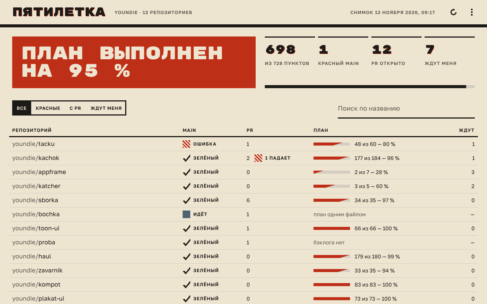
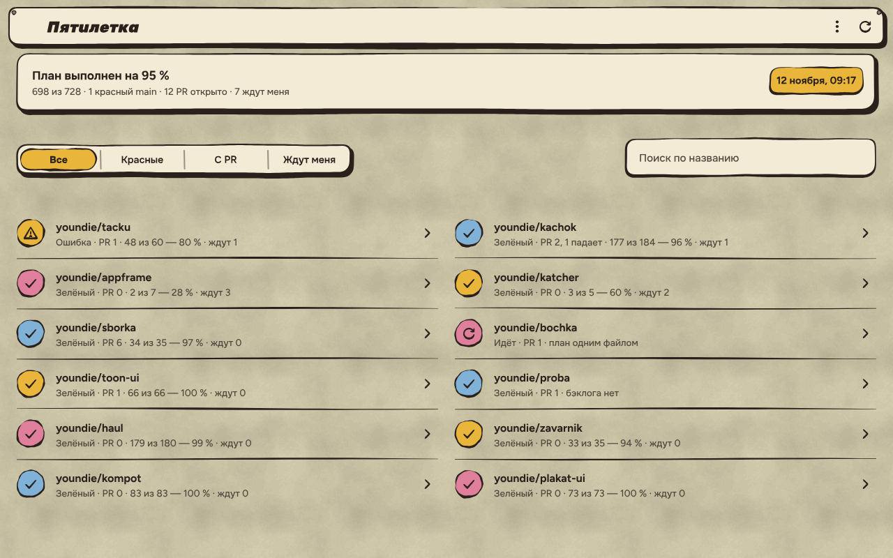
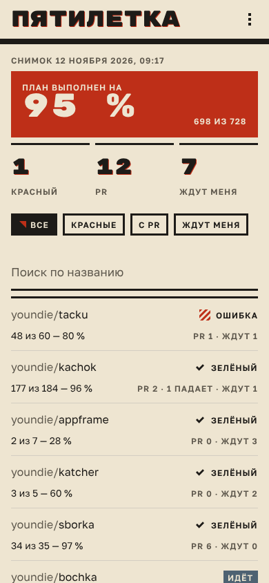
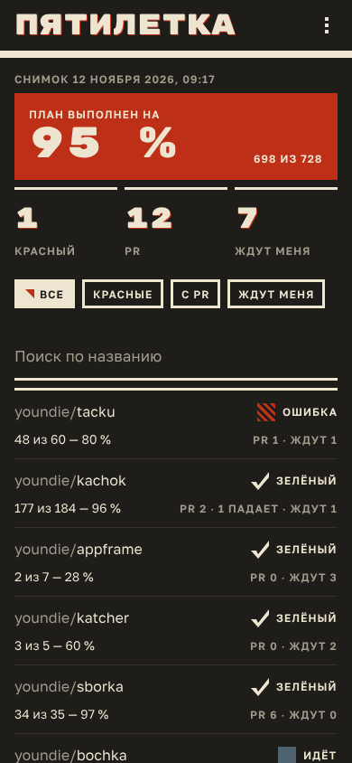
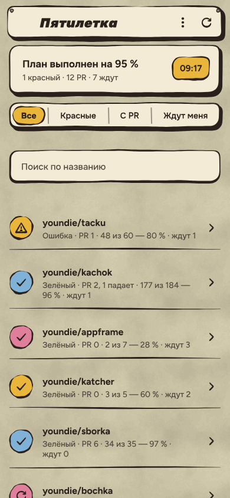
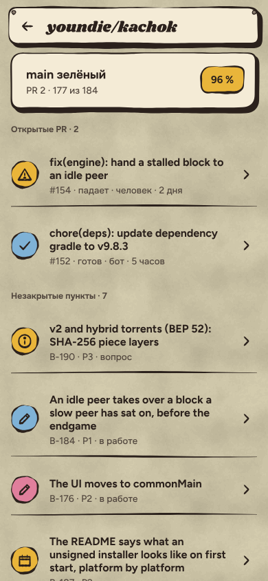

<div align="center">

# Пятилетка · pyatiletka

**One screen that answers "where do I look first?" across a portfolio of GitHub repositories.**

[](https://github.com/youndie/pyatiletka/actions/workflows/check.yaml)
[](https://youndie.github.io/pyatiletka/)
[](LICENSE)

</div>

<table>
  <tr>
    <th>plakat-ui — Soviet poster, 1919–32</th>
    <th>toon-ui — 1940s–50s cartoon</th>
  </tr>
  <tr>
    <td></td>
    <td></td>
  </tr>
</table>

## What it shows

One row per repository, sorted so the trouble comes first:

| Column | Where it comes from |
|---|---|
| **main** | CI of the default branch: green, red, running |
| **PR** | Open pull requests, and how many of them fail |
| **Plan** | Backlog completion, read from the repository's [docs-bootstrap](https://github.com/youndie/docs-bootstrap) backlog index |
| **Waiting** | Backlog items marked `question`: decisions only the owner can make |

The header adds these up for the whole portfolio. Filters (red, with PRs, waiting for me) and a
search narrow the list. A row opens the repository's card: its PRs, checks and backlog items, each
linking to GitHub. Esc closes the card.

## Two kits, one board

Pyatiletka is also the first real consumer of two Compose Multiplatform UI kits,
[plakat-ui](https://github.com/youndie/plakat-ui) and [toon-ui](https://github.com/youndie/toon-ui).
Every screen is built twice over the same state, and the skin can be switched while the board is open
without losing the open card, the filter or the search. Whatever the board turned up about a kit is
filed in that kit's tracker and logged in [kit-findings](docs/kit-findings.md).

| Skin | Themes | Try it |
|---|---|---|
| Poster | paper, black | [paper](https://youndie.github.io/pyatiletka/?skin=plakat&theme=paper) · [black](https://youndie.github.io/pyatiletka/?skin=plakat&theme=black) |
| Cartoon | light, night, bright | [light](https://youndie.github.io/pyatiletka/?skin=toon&theme=light) · [night](https://youndie.github.io/pyatiletka/?skin=toon&theme=night) · [bright](https://youndie.github.io/pyatiletka/?skin=toon&theme=bright) |

<p align="center">
  
  
  
  
</p>

The pictures are the screenshot tests' goldens, drawn from sample data of public repositories.

## How it gets its data

There is no server, and the board only reads: it never merges, re-runs or comments.

- **Web** (wasmJs): the page reads a `snapshot.json` that an hourly workflow collects and publishes
  next to it on GitHub Pages. Public repositories only.
- **Desktop** (JVM): the app collects the snapshot itself, on a timer and on demand. It uses your
  GitHub token from `gh auth token` or `PYATILETKA_GITHUB_TOKEN`. The token is never written to disk
  or to a log, and there is no field to type it in.

## Run it

```bash
./gradlew :app:run                                 # the desktop window
./gradlew :app:wasmJsBrowserDevelopmentRun         # the page, served locally
./gradlew :collector:installDist                   # the snapshot collector, as a CLI
collector/build/install/collector/bin/collector --owner <login> --public-only --out snapshot.json
```

JDK 25. The checks CI runs are `./gradlew check` and `make check` (the documentation gate).

## Modules

| Module | What it is |
|---|---|
| [`core`](docs/services/core.md) | The model, the board's rules and every screen's state; no UI |
| [`collector`](docs/services/collector.md) | Reads GitHub into a snapshot; the desktop app and the CLI share it |
| [`skin-plakat`](docs/services/skin-plakat.md) | The screens on plakat-ui |
| [`skin-toon`](docs/services/skin-toon.md) | The screens on toon-ui |
| [`app`](docs/services/app.md) | The desktop window and the web page: data sources, settings, navigation |

## Documentation

The documentation is in Russian and starts at [docs/](docs/README.md): the
[research](docs/research/research-architecture.md) behind the architecture, features with their
acceptance scenarios, screens, and the [backlog](backlog.md).

## License

[MIT](LICENSE)
